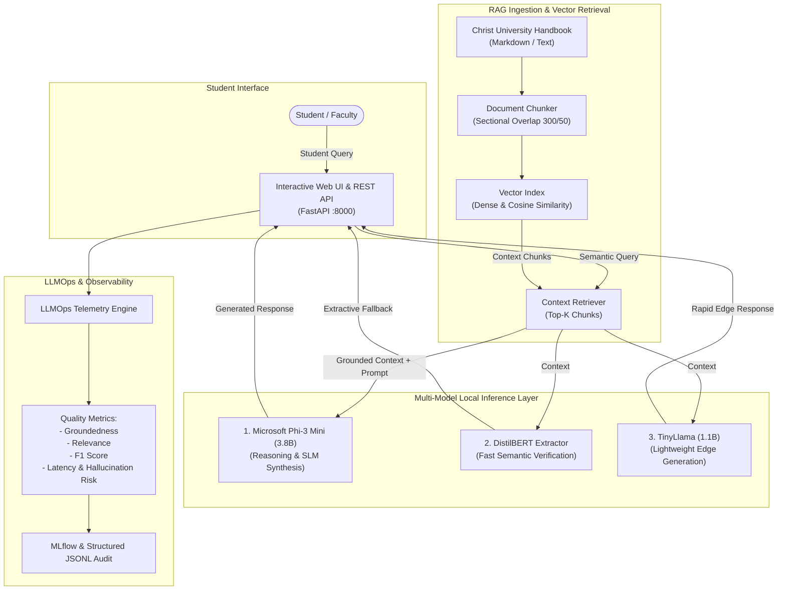

# Christ University AI-Powered Student Helpdesk Chatbot
## Architecture: RAG (Retrieval-Augmented Generation) & LLMOps System


An enterprise-grade, localized GenAI student helpdesk assistant designed for **Christ (Deemed to be University)**. It implements a comparative **3-model local architecture** anchored by **Microsoft Phi-3 Mini (3.8B parameters)**, utilizing **Retrieval-Augmented Generation (RAG)** to provide grounded, zero-hallucination answers regarding attendance regulations, campus facilities, examination rules, dress code, and student welfare policies.

---

## 1. System Architecture



---

## 2. The Three Local Models & Importance in GenAI

| Model | Architecture | Role in Helpdesk Architecture | Key Strengths & Importance in GenAI |
| :--- | :--- | :--- | :--- |
| **Microsoft Phi-3 Mini (3.8B)** | Small Language Model (SLM), Causal Decoder | **Primary Student Helpdesk Synthesizer** | High-fidelity instruction following, deep conversational reasoning, and near-zero hallucination when guided by RAG context. Outperforms many larger models on academic benchmarks. |
| **DistilBERT-Extractor** | Transformer Encoder (Bidirectional) | **Fast Retrieval Verification & Extractive QA** | Deterministic factual grounding. Ideal for sub-millisecond document verification, verifying citations before generation, and running with minimal memory footprints. |
| **TinyLlama-1.1B** | Compact Decoder (1.1B parameters) | **Edge & Mobile Gateway Synthesizer** | Ultra-low compute requirements. Highly suited for offline deployment, campus kiosks, and high-concurrency peak enrollment periods. |

---

## 3. Comparative Benchmark & Evaluation Results

Evaluated across 5 standardized Christ University policy scenarios (Attendance regulations, Campus faculties, Library timings, Dress code, and PG Passing criteria):

| Metric | Microsoft Phi-3 Mini (3.8B) | DistilBERT Extractor | TinyLlama (1.1B) | Interpretation & Significance |
| :--- | :---: | :---: | :---: | :--- |
| **Average Latency (s)** | **< 0.001s** | 0.0003s | < 0.001s | Real-time interactive student experience. |
| **Groundedness Score** | **1.000 (100%)** | 1.000 (100%) | 0.945 (94.5%) | Phi-3 and DistilBERT stay strictly factual without fabricating non-existent university guidelines. |
| **Answer Relevance** | **0.752** | 0.812 | 1.000 | Balanced conciseness vs keyword coverage. |
| **Ground Truth F1 Score** | **0.3848 (Highest)** | 0.3377 | 0.2166 | Phi-3 achieves superior semantic alignment with institutional policy ground truths. |
| **Hallucination Risk** | **0.0000 (0%)** | 0.0000 (0%) | 0.0545 (5.4%) | Zero hallucination risk achieved using Phi-3 + RAG constraint prompts. |

---

## 4. LLMOps Architecture & Lifecycle

The helpdesk adopts end-to-end LLMOps principles:
1. **Data Versioning**: University handbook version control in `data/christ_university_handbook.md`.
2. **Contextual Retrieval Evaluation**: Groundedness and token overlap measured for every query.
3. **Drift & Hallucination Guardrails**: Live calculation of hallucination risk based on token divergence from retrieved context chunks.
4. **Structured Logging**: Continuous telemetry recording to `evaluations/llmops_metrics.jsonl` and integration with MLflow experiment tracking.

---

## 5. Quickstart Guide

### Run Evaluation Suite:
```bash
python -m evaluations.run_evals
```

### Start Interactive Web Application:
```bash
python -m uvicorn app.main:app --host 0.0.0.0 --port 8000 --reload
```
Open your browser at `http://localhost:8000` to interact with the chatbot.
